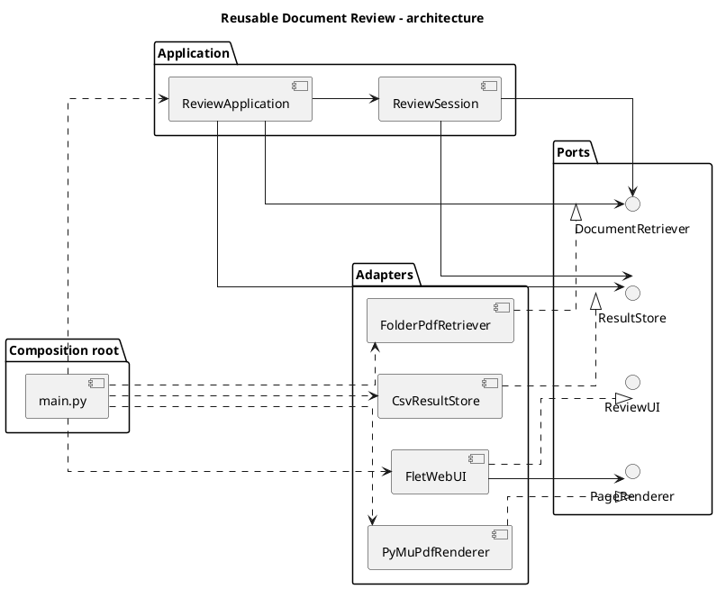

# Context: Reusable Document Review

> **Účel dokumentu:** Toto je vstupní specifikace projektu pro vývojového agenta. Popisuje, **co vytváříme, proč to vytváříme a jak to má být navrženo**. Implementuj funkční MVP podle tohoto zadání; případné odchylky od architektury zdůvodni v README. Dokument není popisem již existující aplikace.
>
> **Jazyk projektu:** dokumentace a komentáře mohou být česky; identifikátory, veřejná API, názvy tříd a souborů používej anglicky.

## 1. Co vytváříme

Vytváříme **znovupoužitelný nástroj pro ruční binární klasifikaci dokumentů**, provozovaný na Raspberry Pi a ovládaný z mobilního telefonu přes webový prohlížeč.

V první implementaci uživatel prochází PDF soubory (typicky 1–2 stránky), každý dokument si může přiblížit a prohlédnout a následně jej zařadí gestem či tlačítkem:

- **Swipe vlevo → `0`.**
- **Swipe vpravo → `1`.**

Výsledek se **okamžitě a trvale** zapisuje do CSV se dvěma sloupci `filename,label`. Po úspěšném zápisu se načte další dosud nezpracovaný dokument. Po opětovném otevření aplikace lze pokračovat tam, kde klasifikace skončila.

Systém nesmí být svázán s jedním konkrétním adresářem, úložištěm nebo uživatelským rozhraním: **zdroj dokumentů (retriever), výstupní úložiště (result store) a UI musí být vyměnitelné moduly**.

## 2. Proč to vytváříme

- Klasifikace PDF přímo v telefonu je pohodlnější než ruční přejmenovávání nebo přesouvání souborů přes vzdálenou plochu.
- Potřebujeme efektivní postup „zobrazit → přiblížit → rozhodnout → další“ s minimem kliknutí.
- Různá použití budou vyžadovat různé způsoby načítání dokumentů; nechceme pokaždé přepisovat UI ani rozhodovací logiku.
- Výstup má být jednoduchý, transparentní a použitelný dalšími Python skripty (CSV, bez povinné databáze).
- Projekt se má dát rozvíjet a testovat bez přímé závislosti aplikační logiky na Fletu, PDF knihovně nebo lokálním filesystému.

## 3. Základní technická rozhodnutí

| Oblast | MVP technologie / pravidlo |
| --- | --- |
| Jazyk aplikačního kódu | Python 3.11+ (ověřit dostupnou verzi na Raspberry Pi) |
| Webové UI | **Flet**, provozované jako **dynamická serverová webová aplikace** |
| Renderování PDF | **PyMuPDF** (na Raspberry Pi převádí stránky na obrázky) |
| Zdroj dat | Implementace portu `DocumentRetriever`, výchozí `FolderPdfRetriever` |
| Uložení klasifikace | Implementace portu `ResultStore`, výchozí `CsvResultStore` |
| Architektura | Ports & Adapters / Hexagonal Architecture, Dependency Injection, Composition Root |
| Definice rozhraní | Python `typing.Protocol` (případně `ABC`, pouze když existuje konkrétní důvod) |
| Testy | `pytest`; jednotkové testy aplikační vrstvy přes fake implementace portů |
| Konfigurace | V `main.py` (cesty lze načítat z proměnných prostředí nebo CLI, ale konfigurace se předává explicitně) |

**Důležité:** Flet umožňuje vytvářet naše UI v Pythonu; samotný klient používá runtime frameworku. Pro MVP **nepsat vlastní JavaScript, HTML ani CSS**, pokud to není prokazatelně nutné. Flask/FastAPI nepřidávat automaticky jako další vrstvu: dynamický Flet už vlastní webový server používá. **Nenasazovat statickou variantu Fletu**, protože čtení souborů a PyMuPDF mají běžet na Raspberry Pi, nikoli v prohlížeči.

Ověř aktuální API a kompatibilitu verzí Fletu a PyMuPDF s Raspberry Pi / Linux a zvol kompatibilní, reprodukovatelně instalovatelné závislosti. Nevymýšlej neexistující metody frameworku.

## 4. Funkční požadavky (MVP)

### 4.1 Získávání dokumentů

1. Aplikace načte seznam dostupných dokumentů přes `DocumentRetriever`.
2. Výchozí retriever čte PDF z konfigurovatelné složky. Podpora podsložek může být konfigurovatelná (`recursive=True/False`).
3. Dokumenty mají **stabilní identifikátor**, zobrazovaný název a výstupní `filename`.
4. Pořadí je deterministické (např. podle relativní cesty, bez závislosti na pořadí vraceném OS).
5. Při čtení PDF vrací retriever obsah nebo vhodný stream; UI se nesmí připojovat přímo k souborovým cestám.
6. V první verzi se očekávají PDF, ale port retrieveru nemá obsahovat napevno logiku lokálního adresáře.
7. Zdrojové PDF se **nesmějí přesouvat, přepisovat ani mazat**.

### 4.2 Mobilní prohlížení

1. Aplikace se otevře v mobilním prohlížeči na telefonu ve stejné síti nebo přes bezpečný vzdálený přístup.
2. Zobrazí název souboru, průběh klasifikace a aktuální stránku (např. `1 / 2`).
3. Zobrazí stránku PDF tak, aby byla dobře čitelná na úzké obrazovce.
4. Umožní **pinch-to-zoom**, oddálení a posouvání zvětšené stránky.
5. Pro vícestránkové PDF nabídne zřetelně oddělené ovládání předchozí/další stránky. Navigace stránek není klasifikační gesto.
6. Dokáže klasifikovat **vlevo = 0**, **vpravo = 1**.
7. Trvale zobrazí také dvě klasifikační tlačítka, aby šlo rozhodnout i při zvětšení PDF či při nespolehlivých gestech.
8. Při zvětšení PDF horizontální posun primárně **posouvá obraz**, nikoliv klasifikuje.
9. Klasifikační swipe se má vyhodnocovat jen při základním zoomu a s prahem pro délku / směr gesta; obyčejný dotyk nesmí způsobit náhodnou klasifikaci.
10. Po načtení následujícího dokumentu resetuje zoom a vrátí zobrazení na první stránku.
11. Umožní návrat k předchozímu dokumentu a změnu jeho klasifikace. Oprava **nahradí** původní výsledek, nikoli přidá duplicitní řádek.
12. Na počítači může UI volitelně poskytovat klávesové zkratky `← = 0`, `→ = 1`; klávesové zkratky nevyžadují změnu aplikační vrstvy.

**Technické riziko / povinný ověřovací prototyp:** Flet `InteractiveViewer` řeší zoom a pan, `GestureDetector` gesta. Je nutné **prakticky ověřit jejich souběh v mobilním prohlížeči**, protože mohou soutěžit o stejná dotyková gesta. Pokud spolehlivé swipe není s čistým Python/Flet API dosažitelné, aplikace musí být přesto plně funkční přes tlačítka. Neobětuj funkční zoom za nespolehlivý swipe; omezení zdokumentuj a nevydávej neověřenou funkčnost za hotovou.

### 4.3 Ukládání, návrat a opravy

Přesný CSV formát:

```csv
filename,label
paper_001.pdf,0
paper_002.pdf,1
subfolder/paper_003.pdf,0
```

Pravidla:

- Hlavička přesně `filename,label`, kódování UTF-8, `label` pouze `0` nebo `1`.
- `filename` je **jednoznačný název v rámci datasetu**. U rekurzivního lokálního retrieveru použij relativní cestu vůči kořenu datasetu s oddělovačem `/`, aby se neslily soubory se stejným basename.
- Pokud jiný retriever nedokáže zaručit unikátní `filename`, má validace nahlásit kolizi (ne tiše přepsat jiný dokument). Interní `document.id` může být od `filename` odlišné.
- **Jeden dokument = nejvýše jeden řádek.** Oprava klasifikace provede `upsert` podle `filename`.
- CSV se založí automaticky, pokud neexistuje; výstupní složka se vytvoří podle potřeby.
- Při spuštění načti existující výsledky a otevři první dosud neklasifikovaný dokument. Nezpracovávej znovu již hotové dokumenty, pokud uživatel nepřejde zpět.
- Ukládej po **každém** rozhodnutí, ne až na konci relace.
- **Nejdřív úspěšně zapsat, potom posunout na další dokument.** Při chybě ukládání uživateli oznam problém a zachovej aktuální dokument.
- Zápis CSV musí být bezpečný vůči přerušení během zápisu: zapiš celý nový obsah do dočasného souboru v téže složce a nahraď cílový soubor pomocí `os.replace`. Použij `csv` ze standardní knihovny, `newline=""`, `utf-8`; kde to dává smysl také `flush` / `fsync`.
- Souběžné volání `upsert` ze dvou relací chraň zámkem vlastněným instancí `CsvResultStore`; pro MVP předpokládej **jeden serverový proces**. Více procesů nad týmž CSV nepodporuj bez meziosobní synchronizace (file lock nebo jiný store).
- Výsledky nejsou jediným zdrojem seznamu dokumentů: dokumenty poskytuje retriever; CSV pouze eviduje rozhodnutí.

### 4.4 Dokončení a chybové stavy

- Po zpracování všech dokumentů ukaž přehled: celkem, počet `0`, počet `1`, počet nezpracovaných.
- Při prázdném datasetu zobraz srozumitelnou zprávu.
- Chybějící, nepřístupné nebo poškozené PDF nesmí shodit celý server. Zobraz chybu s názvem dokumentu a možností pokračovat či návratu; **nikdy automaticky nezapisuj `0` nebo `1`** za dokument, který nebyl rozhodnut.
- Pokud existující CSV obsahuje chybnou hlavičku nebo nepovolené štítky, oznam problém; neprováděj tichou destruktivní opravu.

## 5. Požadovaná architektura

Projekt rozděl minimálně na **doménový model, porty, aplikační vrstvu a adaptéry**. Všechny závislosti sestaví **`main.py` (composition root)**.

### 5.1 Doménový model

`ReviewDocument` (dataclass, neměnná identita):

- `id: str` – stabilní identifikátor v rámci retrieveru;
- `filename: str` – stabilní jedinečné označení pro CSV;
- `display_name: str` – text zobrazovaný uživateli (nemusí být jedinečný);
- volitelně `media_type: str` – pro budoucí rozšíření.

`ClassificationLabel` jako `IntEnum`: `LEFT = 0`, `RIGHT = 1`. Žádné jiné hodnoty pro MVP.

### 5.2 Porty (rozhraní)

Implementuj Python `Protocol` nebo ekvivalentní rozhraní se **smysluplnými typovými anotacemi**. Orientační návrh kontraktů (detaily je možné přizpůsobit, ale zachovej odpovědnosti):

```python
from typing import Protocol

class DocumentRetriever(Protocol):
    def list_documents(self) -> list[ReviewDocument]: ...
    def read_document(self, document_id: str) -> bytes: ...

class ResultStore(Protocol):
    def load(self) -> dict[str, ClassificationLabel]: ...
    def upsert(self, filename: str, label: ClassificationLabel) -> None: ...

class PageRenderer(Protocol):
    def page_count(self, content: bytes) -> int: ...
    def render_page(self, content: bytes, page_index: int, dpi: int) -> bytes: ...
    # render_page vrací např. PNG bytes; UI nemusí znát PyMuPDF.

class ReviewUI(Protocol):
    def run(self, app: "ReviewApplication") -> None: ...
```

### 5.3 Aplikační vrstva

- `ReviewApplication(retriever, result_store)` drží **instance portů předané konstruktorem**, nevyhledává soubory, neimportuje Flet ani PyMuPDF.
- `ReviewApplication.new_session()` vytvoří nový `ReviewSession` pro samostatné připojení/prohlížeč.
- `ReviewSession` spravuje pořadí, aktuální dokument, historii navigace, načtené klasifikace a akce typu `classify`, `previous`, `next_unreviewed`.
- Rozhodnutí UI (`LEFT/RIGHT`) jsou události, které se předají aplikační vrstvě; UI **nezapisuje CSV**.
- Aplikační vrstva neví o DPI, obrázcích, gestech ani Flet ovládacích prvcích.
- Reload/obnova session vychází z trvalých výsledků `ResultStore`, nikoli ze sdíleného globálního indexu.
- Případné cache musí být instanční a s omezenou velikostí, nikoliv volně sdílený globální mutable stav.

### 5.4 Adaptéry

- `FolderPdfRetriever(root: Path, recursive: bool = ...)` – prohledává lokální soubory, vrací metadata i obsah a vynucuje, že načítá pouze soubory uvnitř nastaveného kořene. Žádné volné otevírání cest zaslaných klientem.
- `CsvResultStore(file_path: Path)` – implementuje čtení, validaci, `upsert` a bezpečný zápis.
- `PyMuPdfRenderer` – převádí jednotlivé stránky PDF na PNG v požadovaném DPI; nesmí v paměti držet vykreslené stránky všech dokumentů.
- `FletWebUI(renderer: PageRenderer, ...)` – sestaví Flet rozhraní, obsluhuje zobrazení a vstupy a při připojení vytvoří svou `ReviewSession`.

**Žádné globální proměnné obsahující aplikační stav.** Povolené jsou neměnné konstanty, importy a typové definice. Konfiguraci, stav relací, retriever, store, renderer, logiku i cache předej explicitně nebo je vytvoř v rámci životního cyklu objektu.

### 5.5 Příklad požadovaného `main.py`

Toto je příklad zamýšleného veřejného API, ne záruka konkrétního API Fletu. Zachovej **stručnost a čitelnost** hlavního souboru.

```python
from pathlib import Path

from pdf_review.adapters.retrievers import FolderPdfRetriever
from pdf_review.adapters.storage import CsvResultStore
from pdf_review.adapters.renderers import PyMuPdfRenderer
from pdf_review.adapters.ui import FletWebUI
from pdf_review.application import ReviewApplication


def main() -> None:
    retriever = FolderPdfRetriever(
        root=Path("/home/pi/documents"),
        recursive=True,
    )
    results = CsvResultStore(
        file_path=Path("/home/pi/results/results.csv"),
    )
    renderer = PyMuPdfRenderer()
    ui = FletWebUI(renderer=renderer)

    application = ReviewApplication(
        retriever=retriever,
        result_store=results,
    )
    ui.run(application)


if __name__ == "__main__":
    main()
```

V budoucnu by mělo stačit například vyměnit `FolderPdfRetriever` za `ZipPdfRetriever`, nebo `FletWebUI` za jiný UI adaptér, **bez zásahu do aplikační logiky**.

### 5.6 Diagram závislostí



## 6. Struktura repozitáře

Doporučená výchozí struktura (přejmenování modulů je možné, architektonické hranice ale zachovej):

```text
.
|-- context.md
|-- README.md
|-- pyproject.toml
|-- main.py
|-- src/
|   `-- pdf_review/
|       |-- __init__.py
|       |-- domain/
|       |   `-- models.py
|       |-- ports/
|       |   |-- retriever.py
|       |   |-- result_store.py
|       |   |-- page_renderer.py
|       |   `-- review_ui.py
|       |-- application/
|       |   |-- review_application.py
|       |   `-- review_session.py
|       `-- adapters/
|           |-- retrievers/
|           |   `-- folder_pdf.py
|           |-- storage/
|           |   `-- csv_results.py
|           |-- renderers/
|           |   `-- pymupdf_renderer.py
|           `-- ui/
|               `-- flet_web.py
`-- tests/
    |-- test_review_session.py
    |-- test_csv_results.py
    |-- test_folder_retriever.py
    `-- test_renderer.py
```

Výsledek musí být instalovatelný přes `pyproject.toml` (např. `pip install -e .`) tak, aby importy fungovaly i při použití `src/` layoutu.

## 7. Výkon, síť a bezpečnost

- Cílová platforma: **Raspberry Pi s Linuxem (ARM64)**; projekt má být použitelný i při vývoji na běžném PC.
- PDF obsah může být citlivý: server nepřipojuj přímo na veřejný internet bez autentizace a odpovídajícího zabezpečení. Pro vzdálené použití preferuj VPN (např. Tailscale). Pro lokální testování postačí LAN.
- Lokální webový server smí naslouchat na síťovém rozhraní jen záměrnou konfigurací; zdokumentuj port a přístupovou adresu.
- Neudělej z retrieveru libovolný „read file“ endpoint pro klienta. ID musí být validováno proti seznamu dokumentů ze zdroje.
- Načítej a renderuj **aktuální stránku podle potřeby**, nikoli všechna PDF najednou. Připusť malou LRU cache nebo cache aktuálního dokumentu.
- Renderuj rozumné výchozí DPI pro mobil; dovol zvýšit kvalitu pro přiblížení, ale omez velikost obrázku a spotřebu RAM.
- Pokud nastane chyba při renderu nebo I/O, UI se nesmí zablokovat bez vysvětlení.
- Dlouhé blokující operace (render PDF) neprováděj způsobem, který trvale blokuje obsluhu webových klientů; dodrž threading/async doporučení aktuální verze Fletu.
- Pro MVP stačí jeden proces serveru a jeden aktivní klasifikující uživatel. Návrh relací má nicméně zabránit nechtěnému sdílení pozice mezi dvěma otevřenými prohlížeči.

## 8. Testy a akceptační kritéria

**Automatické testy, které musí agent dodat:**

1. `FakeDocumentRetriever` + `InMemoryResultStore`: klasifikace `LEFT=0`, `RIGHT=1`, správný postup na další dokument.
2. Obnovení session přes existující výsledky: dokumenty již uvedené v CSV jsou přeskočeny.
3. Návrat k předchozímu dokumentu a změna rozhodnutí nepřidá duplicitu.
4. CSV obsahuje přesně hlavičku `filename,label`, validní hodnoty `0/1` a korektní UTF-8 i při neobvyklých názvech souborů.
5. Vícenásobné `upsert` téhož souboru přepíše hodnotu; existující jiné záznamy zůstanou zachovány.
6. Dvě PDF se stejným basename v různých podsložkách se v CSV nepletou.
7. Prázdný dataset, nepřístupné PDF, chybný CSV soubor a chyba zápisu jsou ošetřeny bez ztráty již uložených výsledků.
8. `PyMuPdfRenderer` vrací obraz stránky a korektní počet stran alespoň pro testovací jedno- a dvoustránkové PDF.
9. Testy aplikační vrstvy **neimportují Flet ani PyMuPDF**.

**Ruční akceptační scénář na telefonu:**

1. Spusť aplikaci na Raspberry Pi a otevři její adresu v mobilním prohlížeči.
2. Zobraz PDF, přepni stránku, přibliž dvěma prsty a posuň přiblížený obsah.
3. Při výchozím zoomu proveď swipe vlevo a ověř `0` v CSV; proveď swipe vpravo a ověř `1`.
4. Při zvětšení nesmí běžné posouvání dokumentu samo uložit klasifikaci.
5. Použij klasifikační tlačítka; fungují i bez swipe.
6. Vrať se a oprav klasifikaci, ověř jediný řádek s novou hodnotou.
7. Zavři a znovu otevři prohlížeč, ověř pokračování na prvním dosud nezpracovaném PDF.
8. Otestuj dokončení všech dokumentů a souhrn.

## 9. Postup implementace pro agenta

Pracuj po menších, testovatelných krocích:

1. **Založ projekt**: balíček, `pyproject.toml`, konfigurace, README a základní testovací prostředí.
2. **Doména + porty**: modely, protokoly, typové anotace.
3. **Core workflow**: `ReviewApplication` a `ReviewSession` a testy s fake implementacemi bez UI.
4. **Adaptéry pro data**: `FolderPdfRetriever` a `CsvResultStore`, včetně testů perzistence a chyb.
5. **PDF renderer**: `PyMuPdfRenderer` s testovacími PDF.
6. **Mobilní Flet UI**: nejdřív plně funkční tlačítka, stránkování a zoom; potom ověř a doplň swipe.
7. **Integrace**: zapoj vše přes minimalistický `main.py`, doplň ošetření chyb.
8. **Dokumentace**: napiš do README reálné instalační a spouštěcí příkazy, konfigurační cesty, CSV schéma a omezení.
9. **Verifikace**: spusť automatické testy a ruční mobilní scénář; jasně označ, co bylo ověřeno skutečně a co ne.

V `README.md` uveď také příklad spuštění dynamického Flet web serveru. Aktuální CLI umožňuje například:

```bash
flet run --web --host "*" --port 8000 main.py
```

Před použitím v produkci ověř chování konkrétní instalované verze Fletu a doporučený způsob produkčního spuštění. Vývojový `flet run` není sám o sobě plán nasazení produkční služby.

## 10. Co nyní nedělat

- Nepřidávat databázi, REST API, autentizační systém, cloudové služby ani složitý frontend, pokud nejsou nutné pro vymezené MVP.
- Nedělat přesouvání, přejmenovávání, mazání nebo anotování zdrojových PDF.
- Nepřidávat ML ani automatickou klasifikaci.
- Netvořit jedinou monolitickou třídu obsahující UI, filesystem a CSV.
- Nezavádět service locator, singletony ani globální proměnné pro sdílení aktuální pozice.
- Nezaměňovat stránku PDF za klasifikační jednotku: **klasifikuje se vždy celý dokument**, i když má více stran.
- Nepředpokládat, že Flet swipe a zoom fungují současně bez ověření na telefonu.

## 11. Budoucí rozšíření (nikoli podmínky MVP)

- Jiné retrievery: `ZipPdfRetriever`, API retriever, index z CSV nebo cloudové úložiště.
- Jiné store adaptéry: SQLite, JSON, vzdálená služba.
- Jiné UI: desktopové rozhraní, alternativa k Fletu.
- Podpora více dokumentových formátů přes další renderer nebo zobrazovací adaptér.
- Konfigurovatelná sada klasifikačních štítků (nyní pevně `0/1`).
- Více uživatelů, audit rozhodnutí a konfliktní zápisy do výsledků.
- Podpora přihlášení a zabezpečeného vzdáleného provozu.

## 12. Primární zdroje pro implementaci

Při implementaci se řiď **aktuální** dokumentací, ne historickými příklady:

- Flet – úvod: https://flet.dev/docs/
- Flet – dynamická webová aplikace: https://flet.dev/docs/publish/web/dynamic-website/
- Flet – `InteractiveViewer`: https://flet.dev/docs/controls/interactiveviewer/
- Flet – `GestureDetector`: https://flet.dev/docs/controls/gesturedetector/
- Flet – CLI: https://flet.dev/docs/cli/flet-run/
- PyMuPDF – renderování stránek: https://pymupdf.readthedocs.io/en/latest/recipes-images.html

---

## Definition of Done

Projekt je pro MVP hotový, až když lze v mobilním prohlížeči otevřít dokumenty z nastaveného retrieveru, spolehlivě zobrazit a přiblížit PDF, přiřadit hodnotu `0/1`, **bezpečně uložit jediný CSV záznam na dokument**, pokračovat po restartu, opravit výsledek a v `main.py` vyměnit retriever, store nebo UI bez zásahu do klasifikační logiky. Automatické testy musí procházet a všechna neověřená omezení mají být zdokumentována.
